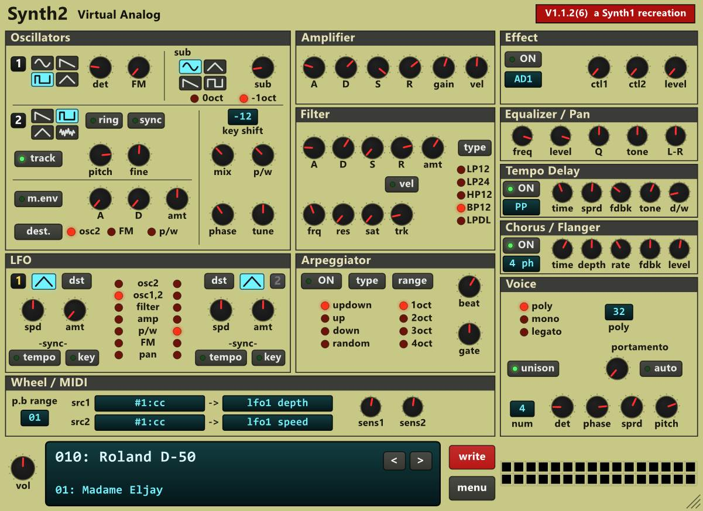

<p align="center"></p>

# Synth2

A free, open-source recreation of **Synth1**, the classic freeware synthesizer by Daichi Laboratory ([website](https://daichilab.sakura.ne.jp/softsynth/index.html)).


Synth1 has been my go-to synth for years, as it has for many musicians, with thousands of patches on the web.
Sadly, it seems to have been abandoned in recent years. No updates, no email replies. Mac users can keep it on life support with Rosetta, but Rosetta will be gone in macOS 28 (see [this article](https://developer.apple.com/news/?id=w5ngl9k2)).

Synth2 aims to keep those sounds playable on modern computers. Open source, so that anyone can keep the project alive in the future.


- **Same parameters, same UI:** Some UX improvements (MIDI Learn, themes, etc.), but nothing was changed in the synth engine.
- **Import patches:** All Synth1 patches (`.sy1` files and zip banks) load just like in Synth1.
- **Carefully modeled with Claude:** Opus 5.5 generated ~ 3 GB of measurement data before modeling every parameter one by one.

Note: the original Synth1 was studied only through its audio output. The binary was never disassembled or decompiled (see the clean-room rule in [AGENTS.md](AGENTS.md#rules)).

Formats: macOS VST3 + AUv2, iPad AUv3, Windows VST3 (x64).

### IMPORTANT:
This version is a fork of Chabs version. It provides several enhancements that Chab didn't include due to him wanting to keep a base version that is faithful to the original. This fork uses a different folder location than Chabs, so as not to cause conflicts. It's pretty much identical feature-wise and the sound engine is identical, though I added a new filter type: Notch.

| Feature | Chab's Synth2 | Synth2 (sl23) |
|---|---|---|
| Filter types | 5 types: LP12, LP24, HP12, BP12, LPDL | 6 types, adding a resonant Notch filter with adjustable peaks |
| Arpeggiator | 4 modes: Up, Down, Up & Down, Random | Adds As Played, following the order notes are pressed
| GUI layout editor | Fixed interface layout | Built-in editor to move controls, resize sections, save custom layouts, undo and redo changes |
| Custom layouts | Factory layout only | Custom layouts stored in layout.json, separately from factory positions |
| Preset favourites | Standard preset browser | Adds a virtual Favourites bank for quick access to preferred presets |
| Preset colour display | Standard browser colouring | Additional preset colour coding, with a user preference to enable or disable it |
| Theme storage | Central themes.json, plus individual theme files | Individual Themes\*.json files only, with separate current-theme state |
| Theme customisation | Standard palette editor | Additional Windows-specific colours for the voice grid, preset browser and selection display |
| GUI interaction | Original Windows control behaviour | Improved LED double-click reset, control positioning, knob interaction and other refinements |
| Portable data | Synth2_Data beside the VST3 bundle | Also supports Synth2_Data beside the internal VST3 binary |
| Standard data folders | Oxo Music\Oxo Synth2 under AppData and Documents | Independent Synth2_Data folders under AppData and Documents |
| Plugin identity | Oxo Synth2 / Oxo Music | Synth2 (sl23) / Dead Channel Audio, with separate VST3 IDs
| Version numbering | Standard three-part version | Four-part version, starting at v1.1.5.25. This will follow Chab's version as far as the first three digits are concerned. |

Both versions retain the original synthesis architecture, including oscillators, envelopes, LFOs, effects, delay, chorus, unison and Synth1 preset support.

This fork deliberately preserves the sound of the five original filter algorithms. The additional Notch algorithm is the principal new DSP feature. The other enhancements primarily affect the GUI, workflow and data management.

Chab's upstream also supports Windows VST3, so the Windows port itself isn't a fork-only feature.

## Download

Official builds are published on the Oxo Music website:

- macOS 14+ (VST3 + AU, signed and notarized): <https://oxo-music.com/products/oxo_synth2>
- Windows 10+ x64 (VST3): <https://oxo-music.com/products/oxo_synth2> (thanks to [sl23](https://github.com/sl2365) for the contribution)
- iPad (AUv3): <https://apps.apple.com/us/app/oxo-synth2/id6829692180>
- Linux: not available yet. Ports are welcome: if you're interested, open an issue to signal you're working on it, fork the repository and open a pull request. Please keep it a 1:1 port of the macOS / Windows versions (no new features).

## Relationship to Synth1

Synth2 is an independent recreation of Synth1 by Daichi Laboratory. It is
**not affiliated with or endorsed by** Daichi Laboratory. No Synth1 code,
binaries or artwork are used. The sound was matched only by measuring the
original plugin's audio output (clean-room; see `tools/s1ref`).

I emailed Daichi in January 2025 and October 2026 to propose
open-sourcing or supporting Synth1, and even offered to raise funds for their
time, but got no reply.

Synth1 is a trademark/work of its respective owner. Patches (`.sy1`) are
loaded for compatibility only; no Synth1 banks are distributed.

> Dear Daichi, if you're reading this: I hope you're well. I'm not trying to take over your project; I'd just love to keep Synth1 patches playable for future generations. Please [contact me](https://oxo-music.com/support/): if you'd rather this project didn't exist, I'll take it down. Above all, I would love to see YOUR original code released under an open-source license. I'd be happy to maintain it if you're open to it.

## Building

Get the sources with their submodules (Steinberg's VST3 SDK, Apple's
AudioUnitSDK):

```sh
git clone --recursive https://github.com/chab/oxo_synth2.git
cd oxo_synth2
# (already cloned without --recursive: git submodule update --init --recursive)
```

A local build keeps the official identity: it replaces an installed Oxo Synth2
(same IDs). That's fine for development; to distribute builds, see
[Forks](#forks).

### macOS (VST3 + AUv2)

Needs a Mac with a recent Xcode (developed with Xcode 27) and CMake 3.25+.

```sh
./build_vst3.sh   # builds and installs the VST3 + AUv2 into ~/Library/Audio/Plug-Ins
```

### iPad (AUv3)

Needs a Mac with a recent Xcode. Open and build `OxoSynth2.xcodeproj` in
Xcode. To run it on a device, Xcode must sign it with **your** Apple developer
team (`Identity.xcconfig` holds the official one). Don't edit that file:
create `Identity.local.xcconfig` next to it with one line:

```
DEVELOPMENT_TEAM = <your Team ID>
```

Your Team ID is shown at developer.apple.com > Account > Membership details.
The file is gitignored, so it stays on your machine.


### Windows (VST3, x64)

Needs Windows 10 / 11 x64, Git, and Visual Studio 2022 or later (Community or
Build Tools) with the "Desktop development with C++" workload, which includes
CMake, plus two individual components from the Visual Studio Installer: "C++
Clang Compiler for Windows" and "MSBuild support for LLVM (clang-cl) toolset".

Note: the build uses clang-cl, which produces faster code than MSVC for this project.

```bat
build_windows.bat   # builds Windows_Build\build\VST3\Release\Synth2.vst3 (does not install it)
```

To test the plugin, close the DAW and copy the bundle into the system VST3
folder from a Command Prompt **run as administrator** (it starts in
`System32`, hence the `cd`; the `rmdir` removes the previous copy so no stale
file stays in the bundle):

```bat
cd /d C:\path\to\oxo_synth2
if exist "%CommonProgramFiles%\VST3\Synth2.vst3" rmdir /S /Q "%CommonProgramFiles%\VST3\Synth2.vst3"
xcopy Windows_Build\build\VST3\Release\Synth2.vst3 "%CommonProgramFiles%\VST3\Synth2.vst3\" /E /I /Y
```

#### Where the Windows version keeps your files

The **Windows Synth2 (sl23) fork** uses its own `Synth2_Data` folders,
separate from the official Oxo Synth2 installation. The built-in data-folder
name is the same in portable and non-portable configurations.

**Without portable mode:**

- **Settings and user data:** `%APPDATA%\Synth2_Data\` (normally
  `C:\Users\<WindowsUsername>\AppData\Roaming\Synth2_Data\`). This is
  where `settings.json`, `theme_current.json`, `Themes\*.json`,
  `midi_mappings.json`, layout and other user-state/index files live.
  Custom themes are individual files in `Themes`; **`themes.json` is not used**.
- **Preset bank library:** `Documents\Synth2_Data\` (your Windows
  *Documents* known folder; it can be redirected, so it is not necessarily
  under `C:\Users`). Imported bank folders live under this library root.

**With portable mode:** create a folder named `Synth2_Data` in either of these
locations (no installation or registry changes required):

1. **Beside the loaded VST3 binary:**
   `Synth2.vst3\Contents\x86_64-win\Synth2_Data\` (inside the VST3 bundle).
2. **Beside the outer VST3 bundle:**
   `<VST3 installation directory>\Synth2_Data\`.

If both portable folders exist, **the binary-adjacent folder takes precedence**.
Portable mode stores settings, individual themes and other user files in that
`Synth2_Data` folder; preset banks live in its `Presets\` subfolder. When
neither portable folder exists, Synth2 uses the two Windows user folders
listed above. Restart your DAW after adding, removing or relocating a portable
folder so all plugin instances use the same selection.

**Existing data is not migrated or deleted automatically.** Older data in
`%APPDATA%\Oxo Music\Oxo Synth2\` and
`Documents\Oxo Music\Oxo Synth2\` is not read by this Windows fork.
Keep a backup and manually copy any desired settings, themes or bank folders
to the new locations before relying on them. When switching to portable mode,
place bank folders under `Synth2_Data\Presets\`, not beside the settings
files. This Windows-only folder change does not alter the macOS/iPad storage
locations, VST3 identity, presets or sound engine.

### Tests

```sh
make -C EngineCoreTests test
```

## Preparing installers

Both scripts read the product name, IDs and version from `Identity.xcconfig`
and write into `dist/` (gitignored).

### macOS (.pkg in a .dmg)

```sh
tools/prepare_mac_installer   # dist/mac/OxoSynth2-<version>-<build>-macOS.dmg
```

One package with Audio Unit / VST3 checkboxes, installing into
`/Library/Audio/Plug-Ins`. Signing and notarization need a Developer ID:
set `OXO_SIGN_ID_APP`, `OXO_SIGN_ID_INSTALLER` and `OXO_NOTARY_PROFILE`
(`xcrun notarytool store-credentials`). `--skip-notarize` makes a local test
build (Gatekeeper refuses it once downloaded), `--skip-build` reuses the last
build. Details at the top of the script.

### Windows (Inno Setup .exe in a .zip)

Needs, on top of the build requirements,
[Inno Setup](https://jrsoftware.org/isinfo.php) 6.3+
(`winget install JRSoftware.InnoSetup`).

```bat
tools\prepare_win_installer.bat   # dist\win\OxoSynth2-<version>-<build>-Windows-x64.exe + .zip
```

Builds the release with clang-cl (static runtime: no VC++ redistributable
needed), validates it, and packs the installer (puts the plugin in
`C:\Program Files\Common Files\VST3`) and the `.zip` (installer, `README.pdf`,
raw bundle). Authenticode signing is optional (`OXO_WIN_SIGN_SHA1` or
`OXO_WIN_SIGN_PFX`, see the top of the script); unsigned, SmartScreen warns
on first run. `--help` lists the options.

## Repository layout

| Path | Contents |
|---|---|
| `EngineCore/` | The synth engine: portable, header-only C++20 (parameters, `.sy1` codec, voices, filters, effects, patch library) |
| `EditorCore/` | Editor services shared by the VST3 and the AUv3 (C bridge to the UI, state, per-user files) |
| `Shared/` | The SwiftUI panel (mac and iPad) |
| `OxoSynth2VST3/` | VST3 plugin (+ the SDK's AUv2 wrapper), CMake |
| `Windows_Build/` | Windows VST3: CMake project, native Win32 / GDI+ editor, vendored zlib |
| `OxoSynth2.xcodeproj`, `OxoSynth2/`, `OxoSynth2AudioUnit/` | iPad app (an "open it in a host" screen) + AUv3 extension |
| `EngineCoreTests/` | Engine unit tests |
| `tools/s1ref/` | Black-box harness for the original Synth1 + the measurement / fitting scripts |
| `tools/s2render/` | Renders the same test jobs through Synth2, for comparison |
| `reference/meta/` | The measurements the engine tables are generated from |
| `third_party/` | Steinberg VST3 SDK, Apple AudioUnitSDK (git submodules) |

`AGENTS.md` is the project's catch-up file for contributors and AI coding
agents: rules, architecture, build / test commands, and the measured facts
about the original and how they were measured.

## Reference data (for engine work)

The engine's tables come from measurements of the original plugin
(`tools/s1ref`, see its README). The results are committed in
`reference/meta/`; `EngineCore/MeasuredTables.hpp` and `LegacyTables.hpp` are
generated from them.

The renders of the original Synth1 (4,270 files, 3.4 GB unpacked) are not in
the repository:

1. Download [synth2-reference.zip](https://oxo-music.com/downloads/synth2-reference.zip) (1.5 GB).
2. Unzip it at the repository root:

   ```sh
   cd oxo_synth2
   unzip ~/Downloads/synth2-reference.zip
   ```

   This adds `reference/renders/` and `reference/derived/` (both gitignored)
   next to `reference/meta/`.

What's inside:

- `reference/renders/manifest_<group>.jsonl`: one line per render, a complete
  job (all 99 parameter values, notes, length, sample rate) plus the WAV it
  produced in the original (`file`, 44.1 kHz float).
- Groups: `sweeps` (every parameter over its range), `pitch`, `filter`,
  `velocity`, and `presets` (416 real-world patches, anonymized as
  `patch0001`…).
- `reference/derived/`: measurement caches (filter / EQ transfer functions)
  used by the fitting scripts.

To compare Synth2 against the original (needs Python 3 with numpy):

```sh
make -C tools/s2render
cd tools/s1ref && python3 compare.py presets   # or sweeps, pitch, filter, velocity
```

A port to another platform can use the same data: render each manifest job
with the new engine and compare it to the WAV.

Regenerating the renders needs the original Synth1 AU, an Intel-only binary
that runs only on macOS versions that still ship Rosetta. Once Rosetta is gone,
this archive is the only way to compare against the original.

Contributors: the clean-room rule applies. Study the original only through
its audio output and its published plugin interface. Never disassemble or
decompile it, and never copy its artwork.

## Forks

You are welcome to fork and redistribute (MIT). If you work with an AI coding
agent, point it to `AGENTS.md` first: it is written for agents to catch up
with the project (rules, architecture, commands, measured facts), and most
agents read it automatically. Keep it up to date as you go.

If you ship your own builds, give them **their own identity** so they can be
installed next to the official ones without host conflicts. The upstream
macOS/iPad identity lives in `Identity.xcconfig` (or an override in
`Identity.local.xcconfig`); the Xcode project and macOS build read it. The
Windows-only sl23 fork instead reads `Windows_Build/Identity.txt` (optionally
overridden by `Windows_Build/Identity.local.txt`), including its separate
`Synth2_Data` user-folder names.

| Key | Used for |
|---|---|
| `OXO_PRODUCT_NAME` | Display name, bundle names (`<name>.component`, `<name without spaces>.vst3`), installer |
| `OXO_VENDOR` | VST3 vendor |
| `OXO_VENDOR_WEBSITE`, `OXO_VENDOR_EMAIL` | VST3 info, update dialog contact (host only, no `https://`) |
| `OXO_UPDATE_PRODUCT` | "Check for updates" slug on your website; **leave empty** to remove the menu entry |
| `OXO_BUNDLE_ID` | Mac `.vst3` / `.audiounit`, iPad app (as is) and extension (`.AudioUnit`), installer package IDs |
| `OXO_APP_GROUP` | iPad app group (bank library shared by the app and the extension) |
| `OXO_AU_MANUFACTURER`, `OXO_AU_SUBTYPE` | Audio Unit 4-char codes (all-lowercase manufacturer codes are reserved by Apple) |
| `OXO_AU_NAME` | Audio Unit name (`Vendor: Product`) |
| `OXO_VST3_PROCESSOR_UID`, `OXO_VST3_CONTROLLER_UID` | VST3 class IDs: generate fresh ones (`uuidgen`) |
| `OXO_DATA_FOLDER`, `OXO_LIBRARY_FOLDER` | Mac per-user folders (`~/Library/Application Support/…`, `~/Music/…`) |
| `DEVELOPMENT_TEAM` | Your Apple signing team (in `Identity.local.xcconfig`) |

Outside that file, replace the app icons:
`OxoSynth2/Assets.xcassets/AppIcon.appiconset` and
`OxoSynth2AudioUnit/Assets.xcassets/AppIcon.appiconset`.

Internal names (`OxoSynth2` targets and files, `Oxo…` message IDs) are not
visible to users and need no renaming. Keep the state tag `'OXS2'` and the
`.sy1` format as they are, so projects and patches stay compatible.

## License

The code is under the [MIT License](LICENSE).

Third-party: Steinberg VST3 SDK (MIT), Apple AudioUnitSDK (Apache 2.0).

The names "Oxo", "Oxo Music" and "Oxo Synth2" and the app icons are not
covered by the code license: forks must use their own name and icons.
