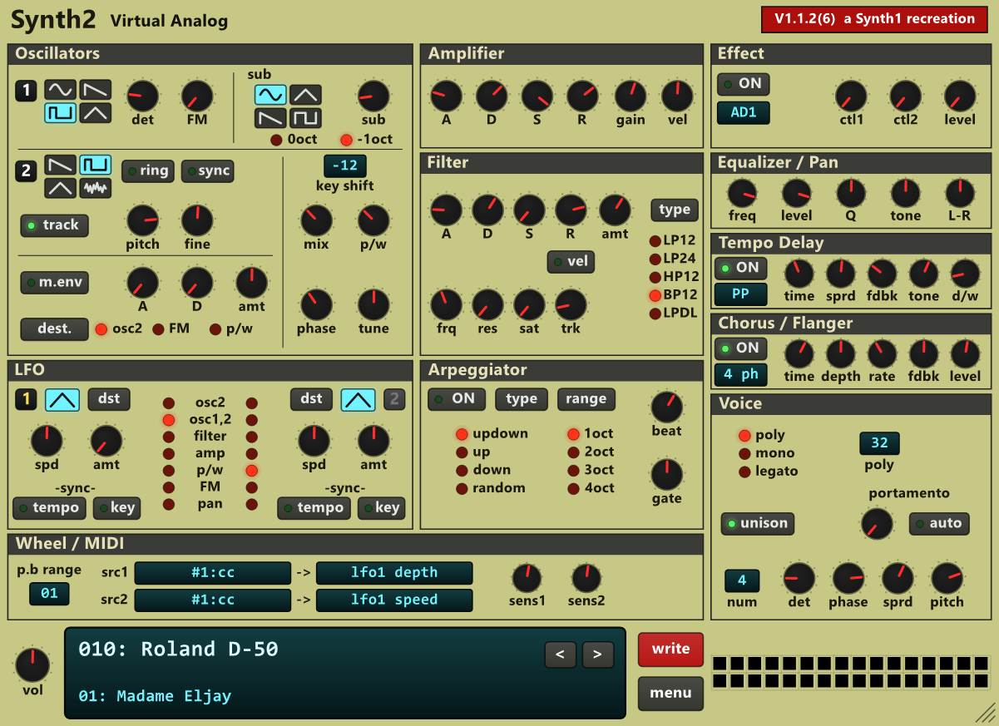

# Synth2

A free, open-source recreation of **Synth1**, the classic freeware synthesizer by Daichi Laboratory ([website](https://daichilab.sakura.ne.jp/softsynth/index.html)).

Synth1 has been my go-to synth for years, as it has for many musicians, with thousands of patches on the web.
Sadly, it seems to have been abandoned in recent years. No updates, no email replies. Mac users can keep it on life support with Rosetta, but Rosetta will be gone in macOS 28 (see [this article](https://developer.apple.com/news/?id=w5ngl9k2)).

Synth2 aims to keep those sounds playable on modern computers. Open source, so that anyone can keep the project alive in the future.

- **Same parameters, same UI:** Some UX improvements (MIDI Learn, themes, etc.), but nothing was changed in the synth engine.
- **Import patches:** All Synth1 patches (`.sy1` files and zip banks) load just like in Synth1.
- **Carefully modeled with Claude:** Opus 5.5 generated ~ 3 GB of measurement data before modeling every parameter one by one.

Note: the original Synth1 was studied only through its audio output. The binary was never disassembled or decompiled (see the clean-room rule in [AGENTS.md](AGENTS.md#rules)).

Formats: macOS VST3 + AUv2, iPad AUv3, Windows VST3 (x64).

### IMPORTANT:
This version is a fork of Chabs version. It provides several enhancements that Chab didn't include due to him wanting to keep a base version that is faithful to the original. This fork uses a different folder location than Chabs, so as not to cause conflicts. It's pretty much identical feature-wise and the sound engine is identical, though I added a new filter type: Notch.

| Feature | Chab's Synth2 | Synth2 (sl23) |
|---|---|---|
| Filter types | 5 types: LP12, LP24, HP12, BP12, LPDL | 6 types, adding a resonant Notch filter with adjustable peaks |
| Arpeggiator | 4 modes: Up, Down, Up & Down, Random | Adds As Played, following the order notes are pressed
| GUI layout editor | Fixed interface layout | Built-in editor to move controls, resize sections, save custom layouts, undo and redo changes |
| Custom layouts | Factory layout only | Custom layouts stored in layout.json, separately from factory positions |
| Preset favourites | Standard preset browser | Adds a virtual Favourites bank for quick access to preferred presets |
| Preset colour display | Standard browser colouring | Additional preset colour coding, with a user preference to enable or disable it |
| Theme storage | Central themes.json, plus individual theme files | Individual Themes\*.json files only, with separate current-theme state |
| Theme customisation | Standard palette editor | Additional Windows-specific colours for the voice grid, preset browser and selection display |
| GUI interaction | Original Windows control behaviour | Improved LED double-click reset, control positioning, knob interaction and other refinements |
| Portable data | Synth2_Data beside the VST3 bundle | Also supports Synth2_Data beside the internal VST3 binary |
| Standard data folders | Oxo Music\Oxo Synth2 under AppData and Documents | Independent Synth2_Data folders under AppData and Documents |
| Plugin identity | Oxo Synth2 / Oxo Music | Synth2 (sl23) / Dead Channel Audio, with separate VST3 IDs
| Version numbering | Standard three-part version | Four-part version, starting at v1.1.5.25. This will follow Chab's version as far as the first three digits are concerned. |

Both versions retain the original synthesis architecture, including oscillators, envelopes, LFOs, effects, delay, chorus, unison and Synth1 preset support.

This fork deliberately preserves the sound of the five original filter algorithms. The additional Notch algorithm is the principal new DSP feature. The other enhancements primarily affect the GUI, workflow and data management.

Chab's upstream also supports Windows VST3, so the Windows port itself isn't a fork-only feature.

## Download

Official builds are published on the Oxo Music website:

- macOS 14+ (VST3 + AU, signed and notarized): <https://oxo-music.com/products/oxo_synth2>
- Windows 10+ x64 (VST3): <https://oxo-music.com/products/oxo_synth2> (thanks to [sl23](https://github.com/sl2365) for the contribution)
- iPad (AUv3): <https://apps.apple.com/us/app/oxo-synth2/id6829692180>
- Linux: not available yet. Ports are welcome: if you're interested, open an issue to signal you're working on it, fork the repository and open a pull request. Please keep it a 1:1 port of the macOS / Windows versions (no new features).

## Relationship to Synth1

Synth2 is an independent recreation of Synth1 by Daichi Laboratory. It is
**not affiliated with or endorsed by** Daichi Laboratory. No Synth1 code,
binaries or artwork are used. The sound was matched only by measuring the
original plugin's audio output (clean-room; see `tools/s1ref`).

Chab emailed Daichi in January 2025 and October 2026 to propose
open-sourcing or supporting Synth1, and even offered to raise funds for their
time, but got no reply.

Synth1 is a trademark/work of its respective owner. Patches (`.sy1`) are
loaded for compatibility only; no Synth1 banks are distributed.

> Dear Daichi, if you're reading this: I hope you're well. I'm not trying to take over your project; I'd just love to keep Synth1 patches playable for future generations. Please [contact me](https://oxo-music.com/support/): if you'd rather this project didn't exist, I'll take it down. Above all, I would love to see YOUR original code released under an open-source license. I'd be happy to maintain it if you're open to it.

#### Where the Windows version keeps your files

The **Windows Synth2 (sl23) fork** uses its own `Synth2_Data` folders,
separate from the official Oxo Synth2 installation. The built-in data-folder
name is the same in portable and non-portable configurations.

**Without portable mode:**

- **Settings and user data:** `%APPDATA%\Synth2_Data\` (normally
  `C:\Users\<WindowsUsername>\AppData\Roaming\Synth2_Data\`). This is
  where `settings.json`, `theme_current.json`, `Themes\*.json`,
  `midi_mappings.json`, layout and other user-state/index files live.
  Custom themes are individual files in `Themes`; **`themes.json` is not used**.
- **Preset bank library:** `Documents\Synth2_Data\` (your Windows
  *Documents* known folder; it can be redirected, so it is not necessarily
  under `C:\Users`). Imported bank folders live under this library root.

**With portable mode:** create a folder named `Synth2_Data` in either of these
locations (no installation or registry changes required):

1. **Beside the loaded VST3 binary:**
   `Synth2.vst3\Contents\x86_64-win\Synth2_Data\` (inside the VST3 bundle).
2. **Beside the outer VST3 bundle:**
   `<VST3 installation directory>\Synth2_Data\`.

If both portable folders exist, **the binary-adjacent folder takes precedence**.
Portable mode stores settings, individual themes and other user files in that
`Synth2_Data` folder; preset banks live in its `Presets\` subfolder. When
neither portable folder exists, Synth2 uses the two Windows user folders
listed above. Restart your DAW after adding, removing or relocating a portable
folder so all plugin instances use the same selection.

**Existing data is not migrated or deleted automatically.** Older data in
`%APPDATA%\Oxo Music\Oxo Synth2\` and
`Documents\Oxo Music\Oxo Synth2\` is not read by this Windows fork.
Keep a backup and manually copy any desired settings, themes or bank folders
to the new locations before relying on them. When switching to portable mode,
place bank folders under `Synth2_Data\Presets\`, not beside the settings
files. This Windows-only folder change does not alter the macOS/iPad storage
locations, VST3 identity, presets or sound engine.

## License

The code is under the [MIT License](LICENSE).

Third-party: Steinberg VST3 SDK (MIT), Apple AudioUnitSDK (Apache 2.0).

The names "Oxo", "Oxo Music" and "Oxo Synth2" and the app icons are not
covered by the code license: forks must use their own name and icons.
